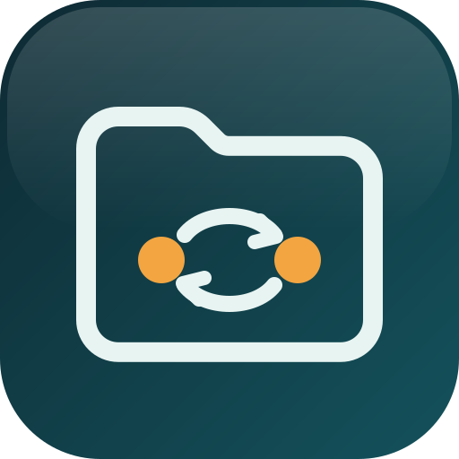

<!-- Copyright (c) 2026 Detlef Beyer -->
<!-- Maintained in the private development repo (public/README.md) and copied here by scripts/publish-public.mjs. -->

# Peerfold

Ein Obsidian-Plugin (nur Desktop), mit dem zwei oder mehr Personen einen Ordner ihres Vaults teilen. Synchronisiert wird Peer-to-Peer: im lokalen Netz, direkt übers Internet und über ein selbst gewähltes, verschlüsseltes Postfach (WebDAV oder S3). Es gibt kein Konto und keinen Peerfold-Server.

*English below.*

## Was es kann

- **Ordner teilen** mit einer Einladung, die du per Mail oder Messenger verschickst. Du bestätigst jeden Beitritt.
- **Ende-zu-Ende-verschlüsselt.** Auch das Postfach sieht nur verschlüsselte Objekte mit unkenntlichen Namen.
- **Keine Daten an Dritte:** keine Telemetrie, keine fremden Server.
- **Konflikte** in Notizen werden zeilenweise zusammengeführt; nichts geht verloren.
- **Anhänge und Links** bleiben im geteilten Ordner intakt.
- Oberfläche auf Deutsch und Englisch.

## Installation

Über [BRAT](https://github.com/TfTHacker/obsidian42-brat):

1. *Einstellungen → Community-Plugins → Durchsuchen*, nach **BRAT** suchen, installieren und aktivieren.
2. *Einstellungen → BRAT* (links unter „Community-Plugins“) → **Beta-Plugin hinzufügen** (*Add beta plugin*).
3. Bei **Repository** `webline/peerfold-obsidian` eintragen, Haken bei **Plugin nach der Installation aktivieren** setzen, **Plugin hinzufügen**. Der Einrichtungsassistent startet.

Schritt für Schritt: [Anleitung, Abschnitt Installation](docs/anleitung.md#installation).

Von Hand: `main.js`, `manifest.json` und `styles.css` aus dem [neuesten Release](https://github.com/webline/peerfold-obsidian/releases/latest) nach `<Vault>/.obsidian/plugins/peerfold/` kopieren. Der Ordner muss genau `peerfold` heißen.

## Anleitung

- [Anleitung (Deutsch)](docs/anleitung.md)
- [Guide (English)](docs/guide.md)
- [Datenschutz und Löschkonzept](docs/datenschutz.md)

## Netzwerkzugriff

Peerfold baut nur diese Verbindungen auf:

| Verbindung | Zweck | Wann |
|---|---|---|
| UDP 47321, Broadcast im LAN | Geräte finden | wenn „Im lokalen Netz synchronisieren“ an ist |
| TCP 47322 (oder frei gewählt) im LAN | Daten austauschen | mit Mitgliedern und eingeladenen Geräten |
| WebRTC direkt zu Mitgliedern | Daten austauschen übers Internet | wenn „Direkt übers Internet verbinden“ an ist und ein Postfach eingetragen ist |
| Eigene STUN/TURN-Server | Erreichbarkeit hinter NAT | nur wenn eingetragen |
| HTTPS zum eingetragenen Postfach | verschlüsselte Objekte ablegen und abholen | nur wenn ein Postfach eingetragen ist |

Andere Server werden nicht kontaktiert, auch keine öffentlichen STUN-Server.

## Fehler melden

Fehler und Fragen bitte als [Issue](https://github.com/webline/peerfold-obsidian/issues). Hier werden nur die veröffentlichten Versionen bereitgestellt; entwickelt wird an anderer Stelle.

---

## English

Peerfold is a desktop-only Obsidian plugin for sharing a folder of your vault with other people: peer-to-peer on the local network, directly over the internet, and through an end-to-end encrypted WebDAV or S3 mailbox you choose. No account, no Peerfold server, no telemetry.

**Install with BRAT:** *Add beta plugin* → `webline/peerfold-obsidian`, then enable **Peerfold**. Or copy `main.js`, `manifest.json` and `styles.css` from the [latest release](https://github.com/webline/peerfold-obsidian/releases/latest) into `<vault>/.obsidian/plugins/peerfold/`.

Full instructions: [guide.md](docs/guide.md).

## Lizenz / License

[MIT](LICENSE)
